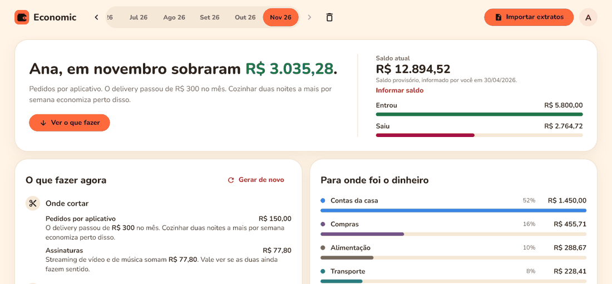
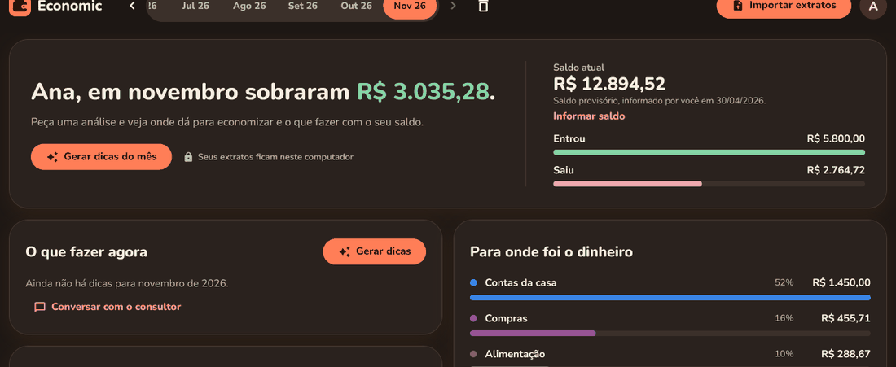
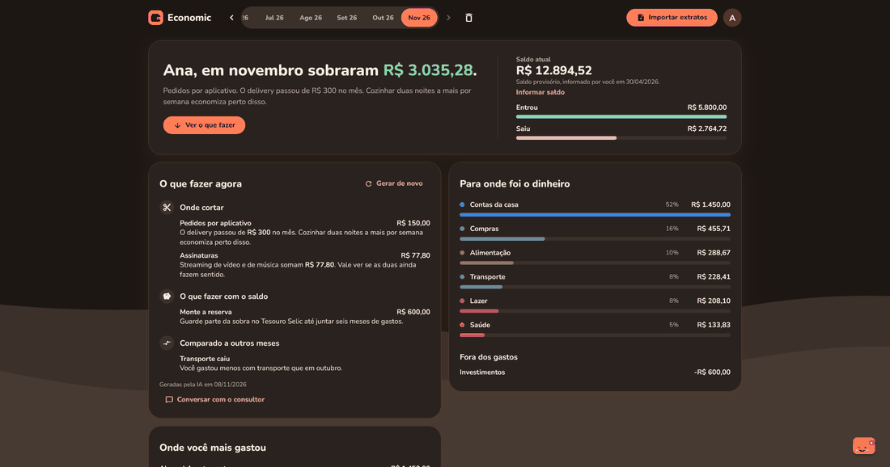
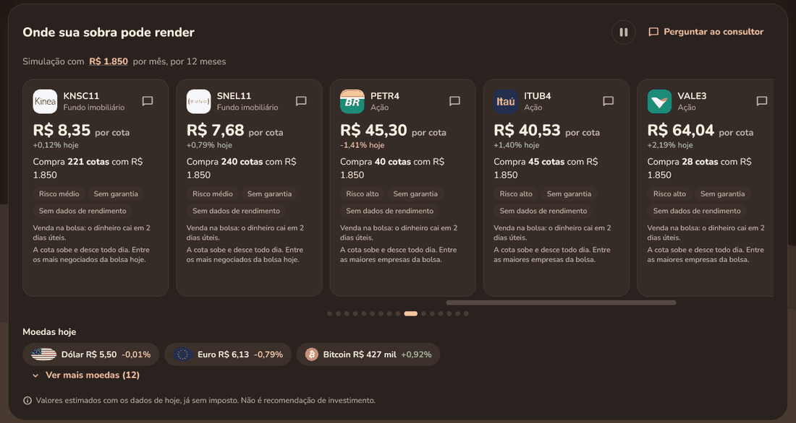
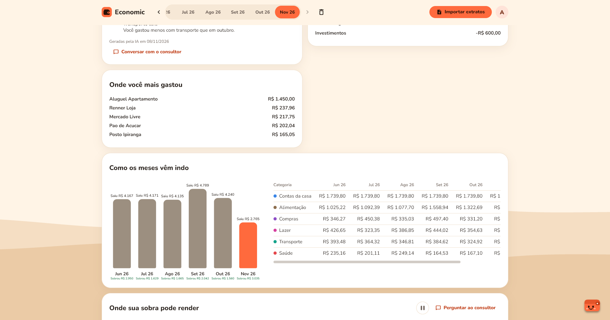
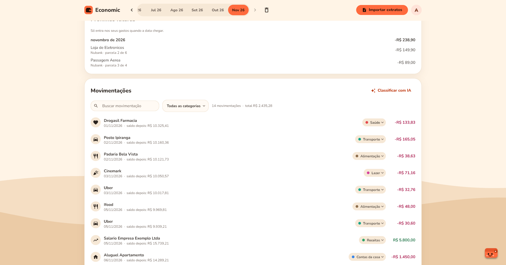
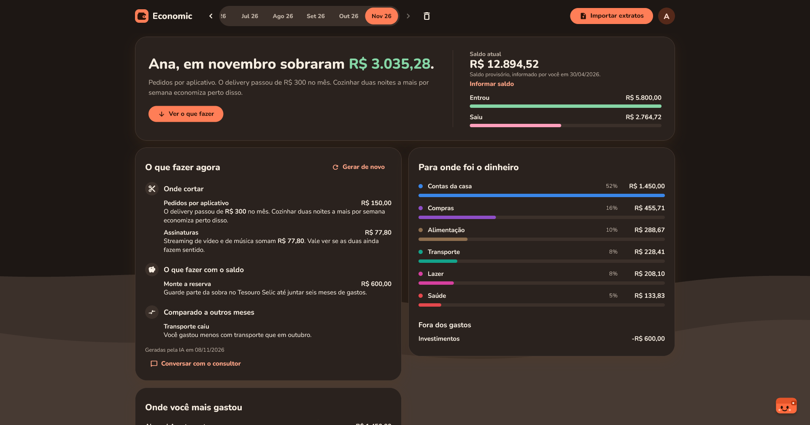
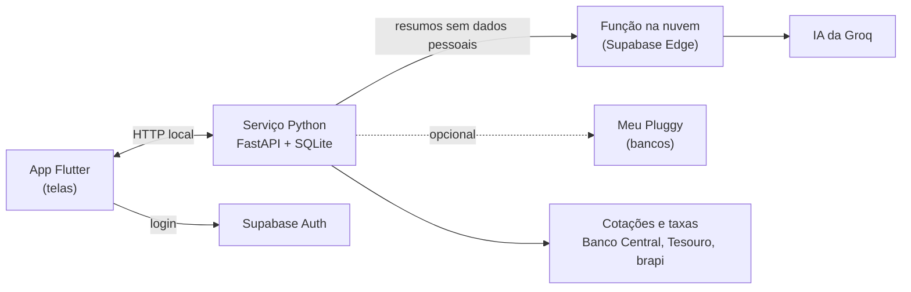

# Economic

**Entenda para onde vai o seu dinheiro.**

O Economic lê o extrato do seu banco, organiza os gastos por categoria e mostra, em linguagem simples, onde cortar e o que fazer com o que sobra.

Gratuito · Windows 64 bits · Seus extratos ficam no seu computador

> As imagens usam dados fictícios.

## O que ele faz

<table>
  <tr>
    <td width="50%" valign="top">
      <h3>Dicas do mês</h3>
      
Com um clique, a inteligência artificial lê o seu mês e diz onde dá para cortar e o que fazer com a sobra.

      
    </td>
    <td width="50%" valign="top">
      <h3>Consultor</h3>
      
Pergunte sobre o seu dinheiro como numa conversa. O consultor responde com base nos seus próprios números.

      
    </td>
  </tr>
  <tr>
    <td width="50%" valign="top">
      <h3>Onde a sobra pode render</h3>
      
Simula quanto a sua sobra renderia no Tesouro, em CDB, na poupança ou em ações, com as taxas e cotações do dia.

      
    </td>
    <td width="50%" valign="top">
      <h3>Como os meses vêm indo</h3>
      
Compara os últimos meses, categoria por categoria, para você ver o que subiu e o que caiu.

      
    </td>
  </tr>
  <tr>
    <td width="50%" valign="top">
      <h3>Todas as movimentações</h3>
      
Busque, filtre por categoria e corrija o que a separação automática errou. As próximas parcelas do cartão aparecem antes de vencer.

      
    </td>
    <td width="50%" valign="top">
      <h3>Claro ou escuro</h3>
      
Siga o tema do Windows ou escolha o que preferir.

      
    </td>
  </tr>
</table>

Também:

- Lê extratos de qualquer banco, nos formatos OFX, CSV, Excel ou PDF.
- Separa os gastos por categoria sozinho e aprende com as suas correções.
- Busca as movimentações sem você importar nada, se você conectar seus bancos pelo Meu Pluggy. É opcional.

## Como instalar

1. Abra a página de [versões](https://github.com/guialbuquerque26/economic/releases/latest).
2. Em **Assets**, baixe o arquivo `economic-instalador-v...exe`, com o número da versão.
3. Abra o arquivo e siga os passos na tela.

O Windows pode mostrar um aviso de editor desconhecido, porque o instalador ainda não tem assinatura digital. Para continuar, clique em **Mais informações** e depois em **Executar assim mesmo**.

## Como usar

1. Crie sua conta e entre no programa.
2. Baixe o extrato no site ou aplicativo do seu banco.
3. Clique em **Importar extratos** e escolha o arquivo.
4. Confira as categorias e peça as dicas do mês.

### Conexão com o banco (opcional)

Quem prefere não importar extratos pode conectar até 5 bancos no próprio nome. Para isso, é preciso criar uma conta sua no [Meu Pluggy](https://meu.pluggy.ai), serviço de terceiro com termos próprios, e seguir o passo a passo em **Conexão com o banco**, no menu da sua conta.

Os dados do Meu Pluggy são atualizados a cada 24 horas, então uma compra pode demorar a aparecer.

## Sua privacidade

- Seus extratos e movimentações ficam guardados no seu computador.
- Seu e-mail, sua senha e as informações pessoais que você preencher ficam na sua conta, na nuvem.
- Se você usar a conexão com o banco, seus dados de acesso ficam criptografados na nuvem, para não precisar digitá-los em cada computador. A chave da criptografia fica conosco. As movimentações vêm da Pluggy direto para o seu computador.
- Para classificar gastos, gerar dicas e responder no consultor, o programa envia a um serviço de inteligência artificial nomes de estabelecimentos, totais do mês e saldos. Ele tenta deixar de fora nomes de pessoas e CPFs, mas essa separação é automática e pode falhar.
- O que você escreve no consultor vai como está. Não escreva CPF, senhas nem nomes de pessoas.

## Como foi feito

O Economic é um app de desktop com um serviço local. Os dados financeiros ficam no computador. A nuvem só cuida da conta e da inteligência artificial.

| Parte | Tecnologias |
|---|---|
| Telas | Flutter para Windows, com tema claro e escuro e animações próprias |
| Serviço local | Python, FastAPI, SQLite, leitura de OFX, CSV, Excel e PDF |
| Nuvem | Supabase (contas e função que chama a IA) e Groq |
| Instalador | PyInstaller e Inno Setup |

Este repositório traz uma amostra do código:

- `telas/`: parte das telas do aplicativo, como o painel, os investimentos e o consultor.
- `backend/`: leitura dos extratos e separação dos gastos por categoria.

É só uma parte: não forma um programa completo e não pode ser executada. Para usar o Economic, instale pela página de [versões](https://github.com/guialbuquerque26/economic/releases/latest).

## Aviso

O Economic ajuda você a pensar nas suas finanças, mas não é banco, corretora nem consultoria. As dicas, as respostas do consultor e as simulações são geradas automaticamente, podem conter erros e não são recomendação de investimento.
